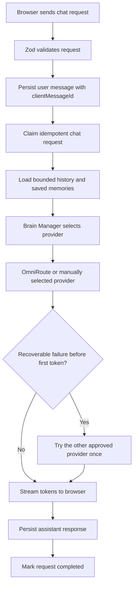

# ZARA Architecture

## Runtime components

- React frontend: chat, provider selection, voice, history, search, saved memory, prompt tools, and browser-selected workspace files.
- Optional Windows Electron shell: serves the same frontend and local Express API, with a sandboxed renderer and a narrow allowlisted native-action bridge.
- Optional Android Capacitor shell: embeds the frontend and connects to a separately hosted HTTPS API using an owner session cookie.
- Express API: request validation, conversation routes, provider status, settings, and SSE chat.
- SQLite: threads, messages, provider state, settings, idempotency records, and FTS5 search.
- Brain Manager: one orchestration layer for exactly two provider adapters.

## Authentication boundary

- One private installation has one owner account; the first-run setup can create it only once.
- Passwords use salted scrypt hashes; raw passwords are never persisted.
- Random session tokens are delivered only through HttpOnly, SameSite=Strict cookies; SQLite stores only token hashes and expiry timestamps.
- All application routes except health and the authentication lifecycle require an active owner session.
- HTTPS is mandatory for any public or remote deployment. Android cross-origin requests use Secure, HttpOnly, SameSite=None cookies and require the exact `https://localhost` origin in the backend CORS allowlist. See [AUTHENTICATION.md](./AUTHENTICATION.md) and [MOBILE.md](./MOBILE.md).

## AI provider decision

1. OmniRoute is the default primary provider.
2. FreeLLMAPI is the backup provider.
3. The user may manually choose either provider for a request.
4. Recoverable connection, timeout, rate-limit, and server errors may trigger one fallback attempt.
5. Authentication errors and user cancellation do not trigger fallback.
6. Once any stream token has been sent to the browser, the request does not switch providers.
7. If both providers fail, the API returns a safe error code without returning credentials or raw upstream response bodies.

## Chat request lifecycle

An authentication failure, user cancellation, or failure after partial output skips the fallback path. Failed requests release the in-progress claim so the same client message ID can be retried without creating a duplicate user message.

## Provider protocol

Both adapters use the OpenAI-compatible API shape:

- `GET /v1/models` for model discovery and verification.
- `POST /v1/chat/completions` for normal and streaming chat.
- The provider settings screen can discover models first, then store a selected non-secret model ID in application settings. Environment model variables override the saved selection.
- `Authorization: Bearer <provider-key>` for authentication.

Default local roots:

- OmniRoute: `http://127.0.0.1:20128/v1`.
- FreeLLMAPI: `http://127.0.0.1:3001/v1`.

These are local service addresses, not hosted provider endpoints. Configure the actual private service root in the backend environment if the service runs elsewhere. Keep model IDs blank until you privately configure a model returned by the provider's model catalog (or a documented `auto` alias where supported).

## Data and permissions

- Provider credentials are read from private backend environment variables or, in the packaged Windows desktop app, Electron safeStorage. Model IDs are non-secret and may be selected in the Settings screen.
- The database startup migration removes unsupported provider rows, clears provider config JSON, and scrubs secret-like legacy settings.
- The backend listens on loopback only; the Vite dev server proxies `/api` requests.
- Saved memory is user-entered, bounded, and added to chat as context; it is not treated as a system instruction.
- Workspace file access uses a browser-selected folder and explicit confirmation before overwriting a file.
- The browser workspace editor does not delete files or execute commands.

## Known boundaries

- This repository currently provides the local-first web application foundation.
- Browser speech recognition depends on browser support and may use the browser vendor's online service. Speech synthesis selects a matching Bengali/English system voice when available and otherwise relies on browser fallback behavior.
- Authentication currently supports one owner per installation, not multiple users or roles. Rate limiting is process-local; a multi-instance deployment requires shared session and rate-limit infrastructure.
- Windows Electron packaging configuration and allowlisted Notepad/Calculator/browser launch actions are present but the installer has not yet been built or verified.
- A manual Android APK build workflow is present but has not been executed or verified. Unrestricted desktop control, background autonomous agents, and external web research are not complete.